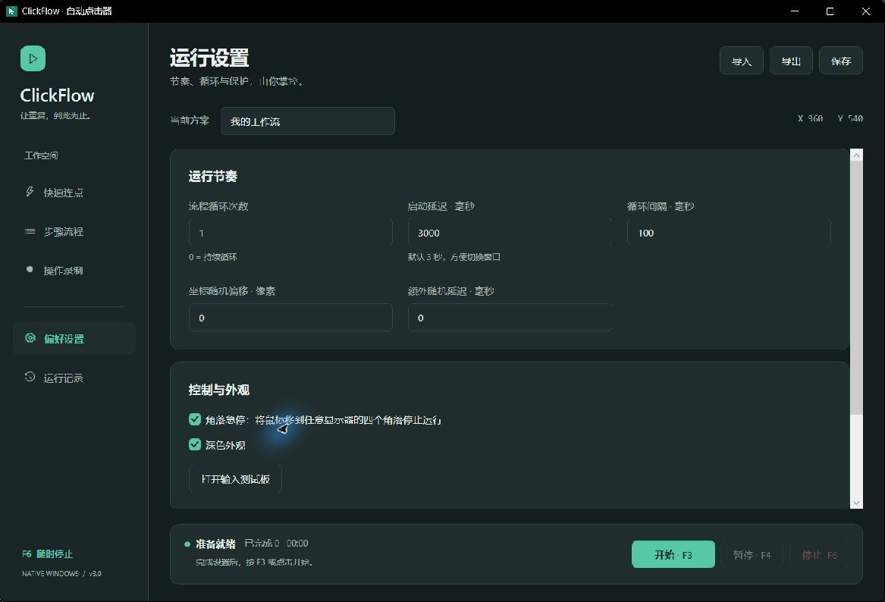

# ClickFlow

让重复，到此为止。面向 Windows 10 / 11 的原生自动点击器，以 C# / .NET 10 / WPF 完整重写。

[下载最新版本](https://github.com/MGHYGitHub/ClickFlow/releases/latest) · [源代码](https://github.com/MGHYGitHub/ClickFlow) · [发布与更新](docs/发布与更新.md)



## 运行

在 [Releases](https://github.com/MGHYGitHub/ClickFlow/releases/latest) 下载 `ClickFlow-版本号-win-x64.exe` 直接运行，或解压同名 ZIP 后双击其中的 `ClickFlow.exe`。便携包附带完整使用说明与运行时许可。已包含 .NET 运行时，无需安装 Python、Java 或 .NET。首次运行需要解包内置原生组件，可能稍慢。运行目标为 Windows 10 22H2 / Windows 11 x64；本次实测环境为 Windows 11，未完成 Windows 10 和混合 DPI 双屏实机测试。

运行前退出旧版点击器，避免其 F3 / F4 / F7 与新版抢占。快捷键注册失败会在「运行记录」显示。

## 三种工作方式

- **快速连点**：左 / 右 / 中键、单击 / 双击、当前位置或固定坐标、指定次数或持续点击。次数 `0` 表示持续运行；间隔单位毫秒，实际最小间隔 10 ms。
- **步骤流程**：依次执行点击、双击、移动、滚轮、键盘组合和等待。每步独立设置位置、执行前等待、次数及间隔；支持启用 / 禁用、编辑、复制和上下移动。
- **操作录制**：录下真实鼠标移动、按下 / 释放、垂直滚轮和按键时序，停止后编辑、删除并回放。录制不会捕获本应用上的操作、软件注入事件和用于切换窗口的系统组合。录制回放不加随机偏移或随机延时。

默认启动等待 3 秒，留出切换目标窗口的时间。启动按钮对应最后选中的工作模式；设置和记录页不会改变该模式。运行期间配置使用快照，步骤编辑、导入导出、录制与执行互斥。

## 快捷键

| 按键 | 功能 |
| --- | --- |
| F2 | 快速连点中拾取固定坐标；步骤流程中添加当前坐标 |
| F3 | 开始 / 停止 |
| F4 | 暂停 / 继续 |
| F6 | 停止执行或录制 |
| F7 | 开始 / 结束录制 |

全局热键被其他软件占用时，可使用界面按钮。按住热键不会反复触发。编辑窗口打开时不会通过全局热键启动任务。默认启用角落急停：把鼠标移动到任一显示器四角的 2×2 像素区域可停止。

暂停时释放本任务按住的鼠标和键盘；继续时恢复逻辑按下状态。停止、失败和退出都会清理输入。拖拽中暂停后，继续前应将指针放回预期位置。

## 点位与时间

坐标是屏幕物理像素，支持多显示器负坐标。分辨率、缩放或窗口布局变化后应重新检查坐标。目标位于屏幕范围外或显示器排列空隙时报告错误，不自动把它移动到另一个位置。

普通动作的「执行前等待」只在进入该步骤时等待一次；「次数」决定重复次数；「重复执行间隔」用于本步重复之间。等待动作使用「重复执行间隔」作为等待时长。滚轮 `+120` 向上、`-120` 向下。键盘组合例如 `Ctrl+C`、`Ctrl+Shift+S`；多个组合拆成多个步骤。

随机偏移是固定点位的 ±N 像素；随机延时是每个动作完成后附加 0–N 毫秒。快速连点按其自身次数和间隔执行；设置中的流程循环与循环间隔用于步骤及录制模式。Windows 调度与目标应用都会影响真实速度，不保证毫秒级硬实时。

## 配置与旧版迁移

新配置默认保存在 `%LOCALAPPDATA%\ClickFlow\workflow.json`。有效编辑会自动保存，也可手动保存或导出。替换保存保留上一个有效版本为 `workflow.json.bak`；输入无效时不会覆盖上次有效配置。启动遇到损坏配置会保留它并停止自动覆盖，此时可通过导出另存有效配置。

「导入」接受新版 JSON、Python 版 `click_points.json` 和 Java 版 `config.properties`。旧配置保持原样，迁移结果另存。转换包括秒 / 毫秒、步骤前后等待、滚轮方向、Base64 名称和 Java 原生键码。无法安全映射的字段或键码会明确拒绝。详见 [旧版审阅与迁移](docs/旧版审阅与迁移.md)。

键盘录制仅保存在本地配置中，不会上传；按键序列可能还原私人输入，请勿把密码录入任务。程序没有遥测，启动时不联网。仅在主动检查或下载更新时访问 GitHub；不会上传配置、操作录制或运行记录。

## 版本更新

打开「偏好设置」中的「版本与更新」，点击「检查更新」。软件读取官方仓库最新稳定 Release，按版本号比较，显示新版本与发布说明入口；预发布版本不会被推荐。GitHub API 限流时改为读取官方最新版附带的 `update.json`。

点击下载后，新版 EXE 保存到 `%LOCALAPPDATA%\ClickFlow\Updates\版本号`，下载完成必须通过 Release 中 `SHA256SUMS.txt` 的 SHA-256 校验。通过「打开下载目录」找到新版，退出 ClickFlow 后将其改名为 `ClickFlow.exe` 并替换旧程序，配置保留在原来的本地数据目录。软件不会自动运行下载的程序或覆盖正在运行的 EXE。

网络不可用、缺少发布资产或文件校验失败时会显示错误，可稍后重试或通过 Releases 页面下载。SHA-256 用于核对发布文件完整性，不是代码签名。当前 EXE 未做 Authenticode 代码签名。

## 外观与自检

「偏好设置」可切换浅色 / 深色。托盘菜单支持打开、暂停、停止、收起和退出；关闭主窗口会停止并退出，普通最小化保留任务栏入口。

「打开输入测试板」提供实际 3 次点击及 ABC 键盘验证。只在按下测试按钮后执行，目标限定为板内控件；失焦、移动或按 Esc 会停止。程序不是后台窗口消息点击器：正常任务会移动真实鼠标，并向当前桌面发送输入。

## 开发

安装 .NET 10 SDK 后，在此目录执行：

```powershell
dotnet build ClickFlow.sln -c Release
dotnet run --project tests/ClickFlow.Tests -c Release
dotnet run --project tests/ClickFlow.UpdateTests -c Release
dotnet run --project src/ClickFlow.Desktop
```

独立便携版：

```powershell
./build.ps1 -Publish
```

输出在 `artifacts/publish/win-x64`。脚本构建并运行核心与更新回归测试，输出目录使用 `artifacts/build`。首次发布需要从 NuGet 下载微软官方运行时和打包工具，业务代码没有第三方 NuGet 依赖。不启用 WPF 不支持的 trimming / NativeAOT。

一次生成 EXE、便携 ZIP、完整源码 ZIP、更新元数据和校验清单：

```powershell
./scripts/package.ps1
```

输出在 `artifacts/release`。所有程序集、界面与产物从 `Directory.Build.props` 读取版本。GitHub Actions 自动验证 push / PR；维护者手动运行「Publish release」工作流发布下一版，流程见 [发布与更新](docs/发布与更新.md)。

使用 `ClickFlow.exe --preview --data-dir <测试目录>` 可运行空跑界面：主任务不发送输入、不注册全局热键、不录制真实操作。输入测试板依然是手动触发的真实测试。开发用 `*.Preview.exe` 名称也启用空跑模式。

`--smoke-test --data-dir <测试目录>` 会在空跑模式打开窗口并自动关闭，用于验证独立包启动、主题资源、配置保存和退出清理；不会触发输入测试板。

## 结构

```text
src/ClickFlow.Core/        数据模型、执行状态机、校验、存储、旧配置迁移
src/ClickFlow.Desktop/     WPF 界面、步骤编辑、输入测试板
  Services/               SendInput、全局热键、鼠标键盘钩子
  Themes/                 浅色 / 深色资源
tests/ClickFlow.Tests/     无第三方依赖的核心回归测试
tests/ClickFlow.UpdateTests/ 版本比较、Release 解析与下载校验测试
scripts/                  版本化发布打包
.github/workflows/         构建测试与手动发布
docs/                     审阅、架构选择、迁移与验证记录
```

## 当前边界

保留了两个旧版的多步骤、录制、暂停、托盘与导入能力；更新模块重新实现为手动检查、校验下载和退出后替换。当前不提供窗口绑定 / 失焦自动暂停、图像识别、后台点击、横向滚轮、鼠标侧键、脚本条件分支或输入法文本重建。完整录制回放、混合 DPI 多屏和跨权限窗口仍需按 [原生输入说明](docs/原生输入说明.md) 验收。

较高权限目标窗口可能拒绝普通权限输入；软件不会自动提升权限。具体构建与测试证据见 [验收记录](docs/验收记录.md)。

## 许可与来源

采用 [MIT License](LICENSE)。由同一作者的 [Python 版 AutoClicker](https://github.com/MGHYGitHub/AutoClicker) 和 [Java 版 Auto-clicker](https://github.com/MGHYGitHub/Auto-clicker) 提炼功能后重新实现。便携包 `licenses/` 保留微软 .NET 运行时许可与第三方声明。
