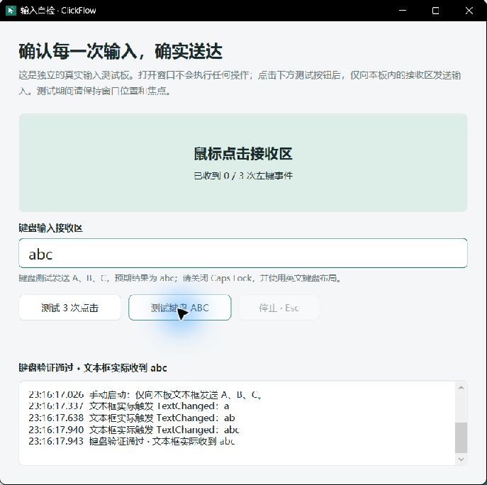

# ClickFlow 验收记录

## 3.1.0 发布前验证

在 Windows 11 x64、.NET SDK 10.0.401 上完成，独立包内置 .NET 10.0.12。

| 检查 | 结果 |
| --- | --- |
| 完整解决方案 Release 构建 | 0 警告、0 错误 |
| 核心回归测试 | 30/30 通过，不发送真实输入 |
| 更新模块回归测试 | 23/23 通过，使用模拟 HTTP 响应 |
| 版本与更新页面 | 实际 WPF 窗口显示 3.1.0，检查中禁用执行入口，错误后恢复 |
| win-x64 单文件 EXE | 成功构建，包含运行时 |
| 最终独立包冒烟测试 | 启动、保存配置、正常退出，ExitCode=0，无 errors.log |
| 发布脚本 | 生成 EXE、便携 ZIP、完整源码 ZIP、update.json 和 SHA256SUMS.txt |

更新测试覆盖数字版本比较、当前版本判断、草稿与预览版拒绝、非法来源/版本/清单、大小限制、API 限流备用通道、官方 CDN 跳转、合法下载、校验失败、取消与临时文件清理。模拟测试不代替不同网络环境中的实际连接验证。

## 3.0 基础能力验证

验证日期：2026-10-11（Asia/Shanghai）。构建环境：Windows 11 x64、.NET SDK 10.0.401；独立包包含 .NET 10.0.12。

## 已完成

| 检查 | 结果 |
| --- | --- |
| 完整解决方案 Release 构建 | 0 警告、0 错误 |
| Core 正式回归 runner | 30/30 通过，约 2 秒，不发送真实输入 |
| 旧配置额外迁移与存储检查 | 20/20 通过；其中主要用例已纳入正式 runner，不能与 30 简单相加 |
| 录制回调逻辑 | 9 项通过，覆盖 Alt/Win 过滤、重复去重、结束补释放；此项没有安装真实钩子 |
| x64 Win32 输入结构 | INPUT 40 字节，联合体 32 字节，偏移 8 字节 |
| 浅 / 深色主窗口、导航、步骤编辑器 | 已启动并检查实际 WPF 窗口 |
| 真实鼠标输入 | 内置测试板实际收到 3/3 次 MouseLeftButtonDown |
| 真实键盘输入 | 内置文本框连续触发 a → ab → abc，结果通过 |
| 独立单文件发布 | win-x64，内置运行时，约 72 MiB |
| 最终独立包自动冒烟检查 | 打开窗口、加载主题、保存配置、关闭并退出，ExitCode=0，没有 errors.log |

鼠标事件记录：23:10:42.092、23:10:42.406、23:10:42.735。设定间隔 300 ms；实测间隔受系统调度影响。键盘事件记录：23:16:17.337、23:16:17.638、23:16:17.940。全部真实输入仅送至新软件自己的测试板。

窗口关闭验收发现过 Closing 回调同步调用 Close 的重入问题，已改为清理后通过 Dispatcher 排队退出，并用最终单文件包的 `--smoke-test` 验证正常保存与退出。浅深主题截图来自实际窗口。

## 核心回归覆盖

倒计时和长等待及时取消、暂停不发送输入、暂停保留剩余等待、停止暂停任务不恢复按住、活动任务拒绝第二次启动、运行快照隔离、输入异常及事件观察者异常后的清理、角落急停、有限次数与无限循环、禁用步骤、等待动作、完成后重新运行、非法计划和保留热键拒绝。

存储覆盖全部设置往返、非法保存保留原文件、备份保留、未知 schema / 重复字段 / 未知字段拒绝。迁移覆盖 Python 键盘与步骤后等待、旧元组和秒转毫秒、Java 点位 / Base64 / 滚轮方向、组合键前移动顺序、原生键码转换、旧 5/6 字段格式以及不安全映射的明确拒绝。

## 尚未完成的实机范围

- Windows 10 22H2、ARM64 / x86（当前发布仅 x64）。
- 混合 DPI、多显示器负坐标的实际点击对齐。
- 真实鼠标拖拽、滚轮及键盘操作的完整录制 → 编辑 → 回放。
- 跨权限窗口、输入法、不同键盘布局、全局快捷键冲突组合。

这些是明确的验证边界，不将模拟测试等同于所有桌面场景通过。实际使用前可先用内置测试板，再以少量次数验证自己的目标窗口。
